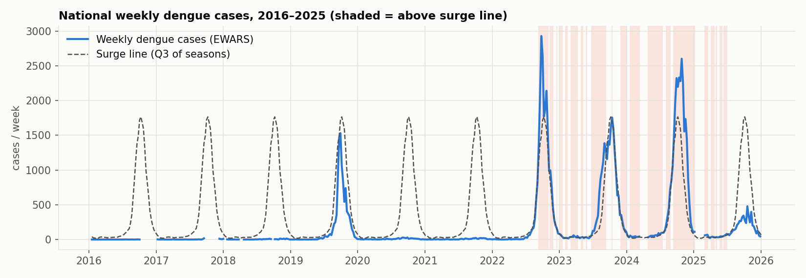
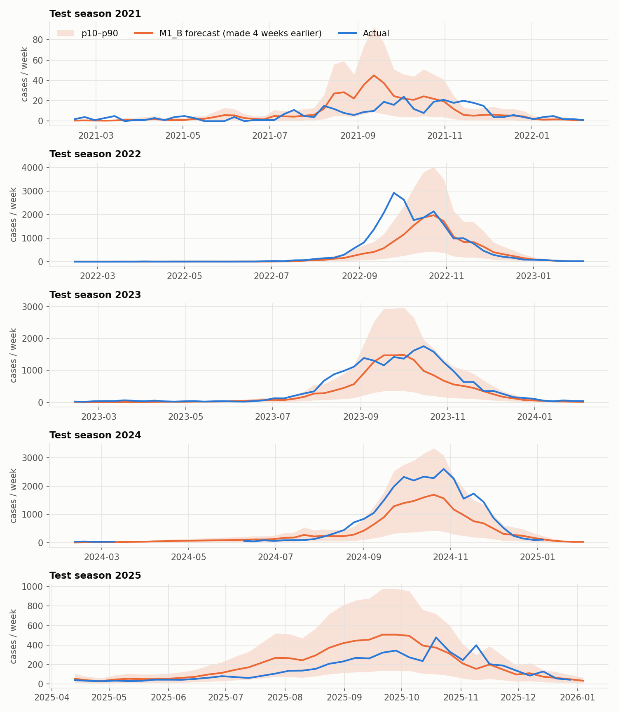
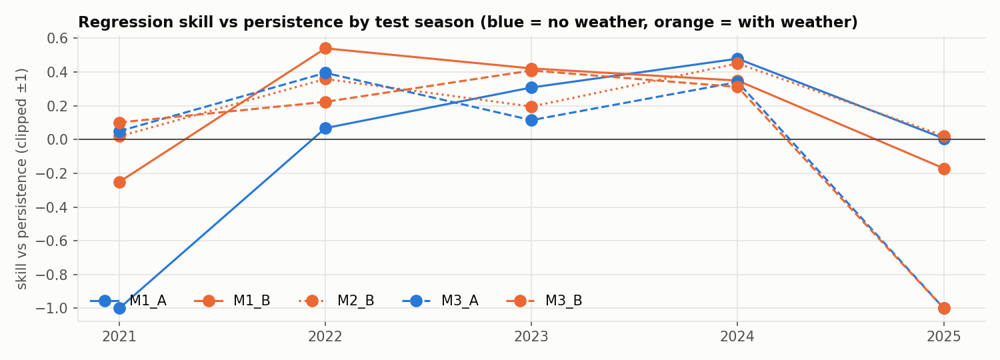
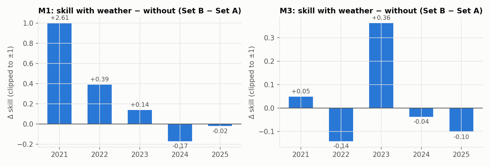

# Results — DengueWatch Nepal

_Generated by `src/evaluate.py` on 2026-10-07. Rolling origin by season; test seasons 2021, 2022, 2023, 2024, 2025; training always on earlier usable seasons only._

## 1. Final model and why

**Regressor: M1_B** (negative-binomial GLM with weather features). **Classifier: M1_A** (logistic regression, no weather). Both were picked with the same simplest-first rule: a more complex model replaces the current one only if it beats it by more than 0.05 skill (regressor) or more than 5% lower Brier (classifier) in a majority of test seasons. M1_B beat M1_A in 3 of 5 seasons; LightGBM (M3) and the temperature spline (M2) never cleared the bar. The forecast skill is real but modest and season-dependent: across seasons the regressor's skill vs seasonal naive ranges -0.17 to +0.87, and vs persistence -0.25 to +0.54. The classifier caught 4/6 surge onsets with mean lead time 3.0 weeks and 0.4 false alarms per season.

Selection log (regressor):
- M1_B vs M1_A: beats by > 0.05 skill in 3/5 seasons (median Δ +0.139) → switch
- M2_B vs M1_B: beats by > 0.05 skill in 2/5 seasons (median Δ +0.022) → keep M1_B
- M3_A vs M1_B: beats by > 0.05 skill in 1/5 seasons (median Δ -0.120) → keep M1_B
- M3_B vs M1_B: beats by > 0.05 skill in 1/5 seasons (median Δ -0.052) → keep M1_B

Selection log (classifier):
- M1_B vs M1_A: Brier > 5% lower in 0/5 seasons (median -18.0%) → keep M1_A
- M2_B vs M1_A: Brier > 5% lower in 0/5 seasons (median -12.3%) → keep M1_A
- M3_A vs M1_A: Brier > 5% lower in 0/5 seasons (median -139.5%) → keep M1_A
- M3_B vs M1_A: Brier > 5% lower in 1/5 seasons (median -85.0%) → keep M1_A

## 2. Surge line — a deviation from the plan

- min training positives per fold: mean+2SD = 0, Q3 = 22 → operational surge line: q3.
- The plan's line (mean + 2 SD per week-of-year) cannot label surges in the seasons it is trained on here: training seasons mix near-zero years (2018, 2020, 2021: <500 cases) with outbreak years (2019, 2022–2024: 9k–29k), and one outbreak season inflates the SD so much that it never crosses its own line. Two of five folds (test 2021, 2023) had **zero** positive training labels, so the classifier could only predict the base rate and caught 0 surges in every season.
- Operational line: **upper quartile (Q3)** of the training seasons' weekly counts, ±2-week pooling (Bortman 1999 endemic channel — 'epidemic zone' above Q3). Still recomputed inside every fold from training seasons only. The rule that picked it was fixed before comparing model results: keep the plan's line unless a fold has < 2 positives. Results under both lines are in `reports/metrics_by_season.csv` (`line_method`).
- Surge onset = first of ≥ 2 consecutive weeks above the line; classifier target = an onset in t+1…t+4.

## 3. Per-season results (operational surge line)

Skill = 1 − MAE / MAE(seasonal naive) on the same weeks; *skill vs persistence* uses this week's count as the baseline (much harder at 4 weeks in 2025). Surges/caught/false alarms/lead time use 🟠 (p ≥ 0.3) as the alert. A surge is *caught* if an alert was issued in the 4 weeks before onset; a *false alarm* is a run of alert weeks with no onset in the next 4 weeks, ignoring weeks already in a surge.

| season | model | set | MAE | skill | skill vs persist. | Brier | PR-AUC | surges | caught | false alarms | lead (wk) | 80% range coverage |
|---|---|---|---|---|---|---|---|---|---|---|---|---|
| 2021 | seasonal_naive | - | 4.7 | 0.00 | -0.07 | – | – | – | – | – | – | – |
| 2021 | persistence | - | 4.4 | 0.07 | 0.00 | – | – | – | – | – | – | – |
| 2021 | endemic_channel | - | – | – | – | 0.154 | 0.10 | 1 | 1 | 0 | 2.0 | – |
| 2021 | M1 | A | 17.8 | -2.78 | -3.04 | 0.060 | 0.37 | 1 | 1 | 2 | 3.0 | 0.33 |
| 2021 | M1 | B | 5.5 | -0.17 | -0.25 | 0.071 | 0.51 | 1 | 1 | 2 | 4.0 | 0.79 |
| 2021 | M2 | B | 4.3 | 0.08 | 0.02 | 0.077 | 0.53 | 1 | 1 | 3 | 4.0 | 0.77 |
| 2021 | M3 | A | 4.2 | 0.11 | 0.05 | 0.159 | 0.20 | 1 | 1 | 5 | 2.0 | 0.48 |
| 2021 | M3 | B | 4.0 | 0.16 | 0.10 | 0.087 | 0.26 | 1 | 0 | 1 | – | 0.58 |
| 2022 | seasonal_naive | - | 435.7 | 0.00 | -0.21 | – | – | – | – | – | – | – |
| 2022 | persistence | - | 360.5 | 0.17 | 0.00 | – | – | – | – | – | – | – |
| 2022 | endemic_channel | - | – | – | – | 0.846 | 0.18 | 3 | 1 | 0 | 3.0 | – |
| 2022 | M1 | A | 336.1 | 0.23 | 0.07 | 0.133 | 0.63 | 3 | 2 | 0 | 3.0 | 0.08 |
| 2022 | M1 | B | 165.7 | 0.62 | 0.54 | 0.146 | 0.61 | 3 | 1 | 0 | 3.0 | 0.79 |
| 2022 | M2 | B | 231.1 | 0.47 | 0.36 | 0.142 | 0.57 | 3 | 2 | 0 | 2.5 | 0.63 |
| 2022 | M3 | A | 218.1 | 0.50 | 0.39 | 0.133 | 0.72 | 3 | 2 | 1 | 2.5 | 0.60 |
| 2022 | M3 | B | 280.1 | 0.36 | 0.22 | 0.291 | 0.36 | 3 | 2 | 1 | 4.0 | 0.67 |
| 2023 | seasonal_naive | - | 197.9 | 0.00 | 0.19 | – | – | – | – | – | – | – |
| 2023 | persistence | - | 243.6 | -0.23 | 0.00 | – | – | – | – | – | – | – |
| 2023 | endemic_channel | - | – | – | – | 0.962 | 0.06 | 1 | 1 | 0 | 4.0 | – |
| 2023 | M1 | A | 168.5 | 0.15 | 0.31 | 0.304 | 0.06 | 1 | 0 | 0 | – | 0.00 |
| 2023 | M1 | B | 141.0 | 0.29 | 0.42 | 0.369 | 0.05 | 1 | 1 | 0 | 4.0 | 0.69 |
| 2023 | M2 | B | 196.0 | 0.01 | 0.20 | 0.377 | 0.06 | 1 | 1 | 0 | 4.0 | 0.65 |
| 2023 | M3 | A | 215.7 | -0.09 | 0.11 | 0.295 | 0.05 | 1 | 0 | 0 | – | 0.73 |
| 2023 | M3 | B | 143.9 | 0.27 | 0.41 | 0.193 | 0.09 | 1 | 0 | 0 | – | 0.63 |
| 2024 | seasonal_naive | - | 333.2 | 0.00 | 0.23 | – | – | – | – | – | – | – |
| 2024 | persistence | - | 478.9 | -0.31 | 0.00 | – | – | – | – | – | – | – |
| 2024 | endemic_channel | - | – | – | – | 0.944 | 0.08 | 2 | 1 | 0 | 4.0 | – |
| 2024 | M1 | A | 262.9 | 0.32 | 0.48 | 0.089 | 0.82 | 1 | 1 | 0 | 3.0 | 0.86 |
| 2024 | M1 | B | 328.3 | 0.15 | 0.35 | 0.110 | 0.23 | 1 | 1 | 0 | 3.0 | 0.86 |
| 2024 | M2 | B | 277.1 | 0.28 | 0.45 | 0.100 | 0.30 | 1 | 1 | 0 | 3.0 | 0.89 |
| 2024 | M3 | A | 342.0 | 0.13 | 0.34 | 0.214 | 0.11 | 1 | 0 | 0 | – | 0.40 |
| 2024 | M3 | B | 357.2 | 0.10 | 0.31 | 0.165 | 0.13 | 1 | 0 | 0 | – | 0.43 |
| 2025 | seasonal_naive | - | 608.4 | 0.00 | -7.83 | – | – | – | – | – | – | – |
| 2025 | persistence | - | 67.8 | 0.89 | 0.00 | – | – | – | – | – | – | – |
| 2025 | endemic_channel | - | – | – | – | 0.487 | – | 1 | 0 | 0 | – | – |
| 2025 | M1 | A | 68.8 | 0.89 | 0.01 | 0.079 | – | 0 | 0 | 0 | – | 1.00 |
| 2025 | M1 | B | 81.0 | 0.87 | -0.17 | 0.079 | – | 0 | 0 | 0 | – | 0.97 |
| 2025 | M2 | B | 68.4 | 0.89 | 0.02 | 0.081 | – | 0 | 0 | 0 | – | 0.97 |
| 2025 | M3 | A | 230.5 | 0.63 | -2.26 | 0.483 | – | 0 | 0 | 2 | – | 0.78 |
| 2025 | M3 | B | 294.6 | 0.53 | -3.17 | 0.193 | – | 0 | 0 | 3 | – | 0.38 |

## 4. Ablation — does weather help?

Δ skill = skill(Set B, with weather) − skill(Set A, no weather). Δ Brier improvement = Brier(A) − Brier(B) (positive = weather helps).

| model | season | skill A | skill B | Δ skill | Brier A | Brier B | Δ Brier improvement |
|---|---|---|---|---|---|---|---|
| M1 | 2021 | -2.78 | -0.17 | **+2.61** | 0.060 | 0.071 | -0.011 |
| M1 | 2022 | 0.23 | 0.62 | **+0.39** | 0.133 | 0.146 | -0.013 |
| M1 | 2023 | 0.15 | 0.29 | **+0.14** | 0.304 | 0.369 | -0.065 |
| M1 | 2024 | 0.32 | 0.15 | **-0.17** | 0.089 | 0.110 | -0.021 |
| M1 | 2025 | 0.89 | 0.87 | **-0.02** | 0.079 | 0.079 | +0.000 |
| M3 | 2021 | 0.11 | 0.16 | **+0.05** | 0.159 | 0.087 | +0.072 |
| M3 | 2022 | 0.50 | 0.36 | **-0.14** | 0.133 | 0.291 | -0.158 |
| M3 | 2023 | -0.09 | 0.27 | **+0.36** | 0.295 | 0.193 | +0.102 |
| M3 | 2024 | 0.13 | 0.10 | **-0.04** | 0.214 | 0.165 | +0.049 |
| M3 | 2025 | 0.63 | 0.53 | **-0.10** | 0.483 | 0.193 | +0.290 |

- **M1 regressor:** weather improves skill in 3/5 seasons → passes the majority rule. **M1 classifier:** weather lowers Brier in 1/5 seasons → fails.
- **M3 regressor:** weather improves skill in 2/5 seasons → fails the majority rule. **M3 classifier:** weather lowers Brier in 4/5 seasons → passes.
- Caveat: M1's biggest gain (2021, Δ +2.61) is M1_A blowing up on only 3 tiny training seasons, not weather adding information. Without 2021, weather helps M1 in 2/4 seasons.

**Verdict: weak, inconsistent evidence.** Weather helped the M1 case-count forecast in 2022–2023 but hurt in 2024–2025, and it made the M1 surge classifier slightly worse in most seasons. By the plan's rule it technically passes for the M1 regressor (Δ > 0 in 3/5), but with five test seasons this is not a robust finding. Do not claim 'weather improves dengue forecasts' — say it *may* help forecast size in some seasons, and that recent case counts carry most of the signal. (MonsoonWatch reached the same conclusion for rainfall and gastro.)

## 5. Limitations

- **National only, weekly.** No district forecasts were built.
- **Forecasts lag sharp rises.** In big seasons the 4-week forecast reaches the peak 2–4 weeks late (see 2022 in the back-test figure); recent cases drive it, so it follows the curve more than it anticipates it.
- **Little use of momentum.** The 2-week growth term gets a coefficient near zero; the model mostly averages the last two weeks' levels. So 'falling from 600 to 300' predicts more than 'rising from 150 to 300', which is why the simple app does not ask about the trend.
- **Weather coefficients are not causal.** In M1_B the minimum-temperature coefficient is negative once week-of-year is in the model; the weather terms mostly act as a seasonal-timing correction.
- **Few seasons.** 8 usable seasons (2018–2025), 5 test seasons; one bad season moves every average. 2016–2017 are unusable (bulletins report only cumulative outbreak totals in the peak weeks).
- **The surveillance network changed.** Sentinel sites grew from ~60 (2016) to 118 (2019) and 134 (2025), and site counts are missing for 2020–2023, so no per-site normalisation: some of the jump after 2019 is the network, not the virus.
- **Counts get revised.** The next bulletin's 'previous week' figure differs from the first-published count by > 10% in ~18% of weeks; the model is trained on first-published counts, which is what is available in real time.
- **Surge line deviation.** The plan's mean + 2 SD line is unusable with these seasons; the Q3 line is lower, so 'surge' here means 'above a typical recent season', not 'exceptional'.
- **Traffic-light cut-offs** (0.3 / 0.6, red also needs p90 > 2× surge line) are the plan defaults, not tuned — too few positive weeks per training fold to tune them without overfitting.
- **COVID years.** 2020–2021 had very low case counts, probably partly from reduced care-seeking and testing.
- **2025 low season** (5,823 EWARS cases vs 29,149 in 2024) is kept as real; seasonal naive is very wrong there, which flatters skill-vs-seasonal-naive — compare against persistence too.
- **Weather is a national average of 67 district points** (mountain and Terai together); the hotspot average is in `weekly_table.csv` (`*_hot`) as a sensitivity input but was not modelled separately.
- **Coverage of the p10–p90 range** is reported per season; NB intervals are often too narrow in outbreak seasons.
